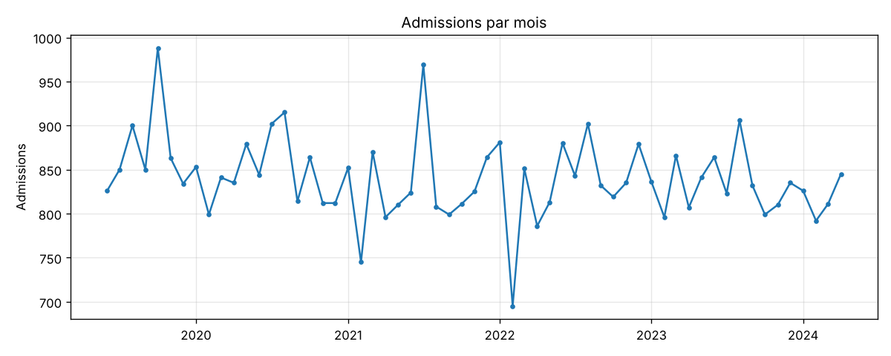
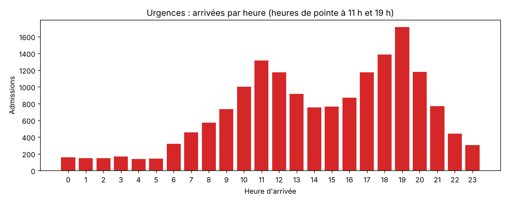
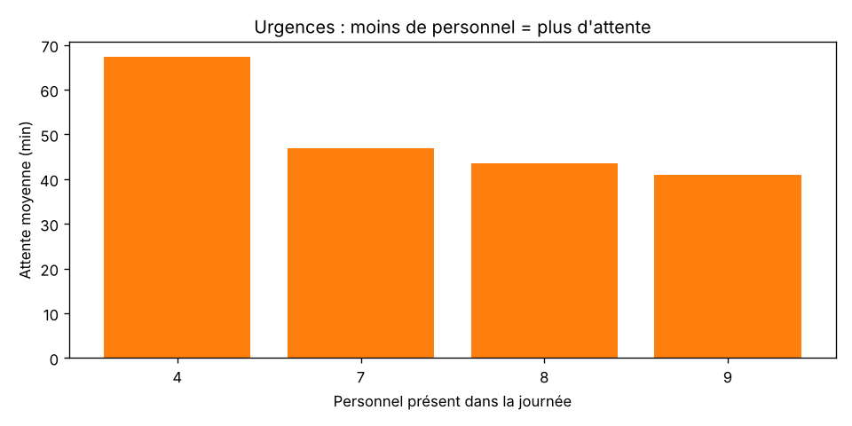
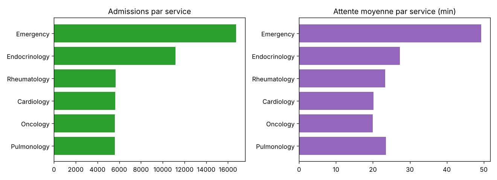
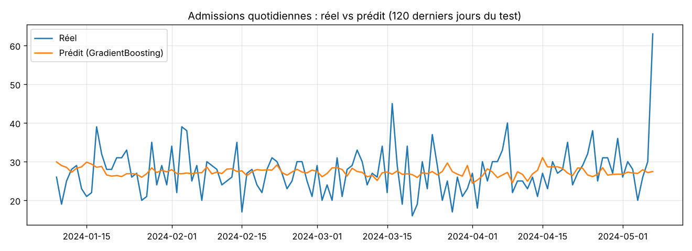
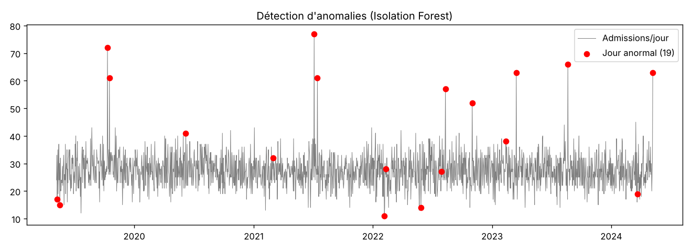

# 🏥 Hospital Operations Intelligence Platform

**Auteures : Hanae MAYTA et Wafae ZALOUK**

Une pipeline de données automatisée qui transforme des données hospitalières **brutes et sales**
en données **propres et fiables** dans un Data Warehouse PostgreSQL, pour ensuite calculer des KPI,
alimenter Power BI, faire du Machine Learning et répondre à des questions en langage naturel.

---

## Sommaire

1. [Le projet en deux minutes](#1-le-projet-en-deux-minutes)
2. [C'est quoi une pipeline ?](#2-cest-quoi-une-pipeline-)
3. [Architecture](#3-architecture)
4. [Les données](#4-les-données)
5. [Les 4 étapes, avec des exemples réels AVANT / APRÈS](#5-les-4-étapes-avec-des-exemples-réels-avant--après)
6. [Le schéma en étoile](#6-le-schéma-en-étoile)
7. [Installation et lancement](#7-installation-et-lancement)
8. [Airflow : l'automatisation](#8-airflow--lautomatisation)
9. [Analytics SQL (15 KPI)](#9-analytics-sql-15-kpi)
10. [Power BI : guide pas à pas](#10-power-bi--guide-pas-à-pas)
11. [Machine Learning](#11-machine-learning)
12. [Agent IA](#12-agent-ia)
13. [Tests](#13-tests)
14. [Arborescence expliquée](#14-arborescence-expliquée)
15. [Choix techniques](#15-choix-techniques)
16. [Résultats](#16-résultats)
17. [Limites et améliorations](#17-limites-et-améliorations)
18. [Dépannage](#18-dépannage)

---

## 1. Le projet en deux minutes

**Le problème.** Un hôpital reçoit ses données de plusieurs logiciels : chaque service écrit les
dates à sa façon (`2024-02-01`, `01/02/2024`, `01-Feb-2024`), appelle les urgences « Urgence »,
« ER » ou « Emergency », exporte parfois deux fois la même admission, et laisse passer des erreurs
de saisie (temps d'attente négatif, âge de 150 ans…). Avec ces données, **un tableau de bord donne
des chiffres faux** : un patient compté deux fois, un service coupé en trois, une moyenne faussée.

**Notre solution.** Une pipeline qui, chaque nuit à 02:00 :

1. **lit** les fichiers bruts,
2. **les nettoie** (formats unifiés, doublons supprimés, erreurs corrigées),
3. **les contrôle** (28 contrôles qualité ; si un contrôle critique échoue, **rien n'est chargé**),
4. **les range** dans une base PostgreSQL organisée en **schéma en étoile**.

Sur ces données fiables, on construit ensuite :

- **15 KPI SQL** (attente, durée de séjour, occupation des lits, réadmissions, heures de pointe…),
- un **tableau de bord Power BI** de 4 pages,
- un **modèle de prévision** des admissions du lendemain et une **détection des jours anormaux**,
- un **agent IA** qui répond à « Pourquoi le temps d'attente était élevé hier ? » en écrivant lui-même le SQL.

---

## 2. C'est quoi une pipeline ?

> **Analogie : une station de traitement de l'eau.**
> L'eau arrive de la rivière **brute** (boue, feuilles, bactéries). Elle passe par des étapes dans
> un ordre fixe : on la **pompe** (Extract), on la **filtre et la traite** (Transform), un laboratoire
> **l'analyse** (Validate) et, seulement si elle est conforme, on l'**envoie dans les canalisations**
> (Load). Personne n'ouvre son robinet en se demandant si l'eau est propre : c'est garanti par la station.
> Si l'analyse échoue, **la station coupe la distribution** plutôt que d'envoyer de l'eau polluée.

Une pipeline de données, c'est exactement ça : une suite d'étapes **automatiques, ordonnées et
contrôlées** qui transforme des données brutes en données fiables. Le Data Warehouse est le
réservoir, et Power BI, le ML et l'agent IA sont les robinets.

Les 4 étapes s'appellent **ETL** : **E**xtract, **T**ransform, (Validate), **L**oad.

---

## 3. Architecture

```
 healthcare_dataset.csv (Kaggle)
            │  scripts/generate_data.py  (enrichit + salit)
            ▼
 data/raw/*.csv
            │
 ┌──────────▼───────── PIPELINE (python -m src.pipeline  OU  DAG Airflow à 02:00) ──────────┐
 │  EXTRACT ──► TRANSFORM ──► VALIDATE ──► LOAD ──► QUALITY CHECK                            │
 │  lit les CSV  nettoie +     28 contrôles  upsert dans   vérifie les volumes                │
 │               features      ✅/❌ ; STOP   PostgreSQL    en base + 0 doublon                 │
 │                             si critique                                                   │
 └──────────────────────────────────┬────────────────────────────────────────────────────────┘
                                    ▼
                 ┌──────── PostgreSQL : hospital_dw (schéma en étoile) ────────┐
                 │     dim_patient   dim_date   dim_department   dim_staff      │
                 │                  ╲      │       │      ╱                     │
                 │                     fact_admission                           │
                 └──────┬─────────────┬─────────────┬──────────────┬────────────┘
                        ▼             ▼             ▼              ▼
                   KPI SQL       Power BI      ML (prévision,   Agent IA
                  (15 requêtes)  (4 pages)      anomalies)     (NL -> SQL)
```

Schémas détaillés (Mermaid : flux, modèle en étoile, DAG) : **[docs/architecture.md](docs/architecture.md)**.

---

## 4. Les données

**Source principale :** le dataset public Kaggle *Healthcare Dataset*
(`data/source/healthcare_dataset.csv`, **55 500 admissions de 2019 à 2024** : patient, âge, sexe,
groupe sanguin, pathologie, dates d'entrée et de sortie, type d'admission, montant facturé…).

Ce dataset ne contient pas certaines informations indispensables à notre sujet. Le script
`scripts/generate_data.py` **l'enrichit de façon réaliste** (seed fixe = résultats reproductibles) :

| Ajouté | Comment | Pourquoi c'est réaliste |
|---|---|---|
| **Service** | Urgences si admission « Emergency », sinon selon la pathologie (Cancer → Oncology…) | un patient est hospitalisé dans le service de sa pathologie |
| **Heure d'arrivée** | urgences : pics à **11 h et 19 h** ; autres services : heures ouvrées | profil observé dans les vrais services d'urgence |
| **Personnel présent** | effectif par jour et par service, avec ~6 % de jours en **sous-effectif** | absences, grèves, vacances |
| **Temps d'attente** | augmente avec le **nombre de patients par soignant** et aux heures de pointe | moins de soignants = plus d'attente |
| **Pics anormaux** | 9 journées avec +30 à +45 arrivées aux urgences, dont le **dernier jour (« hier »)**, combiné à un sous-effectif | épidémie, accident collectif… |

Puis il **salit volontairement** les données pour tester la pipeline : 3 formats de dates,
17 façons d'écrire 6 services, valeurs manquantes, doublons exacts, temps d'attente négatifs ou
absurdes (99 999 min), âges impossibles (150 ans), identifiants de personnel inconnus (`S999`),
dates de sortie avant l'entrée.

> 💡 **Découverte réelle :** le dataset Kaggle contient lui-même **~5 500 doublons cachés** :
> le même séjour (même patient, mêmes dates, même chambre, même facture) apparaît deux fois avec
> seulement l'âge et la casse du nom qui changent. Un simple `drop_duplicates()` ne les voit pas.
> Notre pipeline les détecte grâce à une **clé métier**.

Fichiers produits dans `data/raw/` :

| Fichier | Lignes | Contenu |
|---|---|---|
| `admissions.csv` | 56 394 | une ligne par admission (sale) |
| `patients.csv` | 49 874 | patients (noms en casse aléatoire, doublons) |
| `departments.csv` | 6 | services, lits, capacité quotidienne |
| `staff.csv` | 79 | 78 soignants + 1 doublon |

---

## 5. Les 4 étapes, avec des exemples réels AVANT / APRÈS

### 5.1 Extract — `src/extract.py`

**Rôle :** lire les 4 CSV **sans rien modifier**.

- vérifie que chaque fichier existe (sinon : `Fichier introuvable … Lancez d'abord make data`) et n'est pas vide ;
- lit tout **en texte** (`dtype=str`) : on ne laisse pas pandas deviner les types, c'est le travail de Transform ;
- logue le nombre de lignes lues : `admissions : 56394 lignes lues (16 colonnes)`.

### 5.2 Transform — `src/transform.py`

**Rôle :** nettoyer, puis construire les tables du schéma en étoile.

| Problème | Traitement | Combien (vos données) |
|---|---|---|
| Admission exportée deux fois | suppression sur `admission_id` | **558** |
| Même séjour, âge différent (Kaggle) | suppression sur la clé métier patient + dates + chambre + pathologie | **5 438** |
| 3 formats de dates | conversion format par format (`%Y-%m-%d`, `%d/%m/%Y`, `%d-%b-%Y`) | toutes |
| « Urgence », « ER », « emergency »… | dictionnaire de correspondance `DEPARTMENT_MAPPING` | 17 variantes → 6 noms |
| Sortie avant l'entrée | les deux dates sont inversées (erreur de saisie) | 106 |
| Temps d'attente < 0 ou > 24 h | mis à vide, puis imputé | 630 |
| Facture négative | mise à vide, puis imputée | 96 |
| Âge hors 0–110 ans | mis à vide, puis imputé | 166 |
| Soignant absent ou inconnu | rattaché à `S000` « Non renseigné » | 666 |
| Noms « MoRGAn LAnE » | casse corrigée → « Morgan Lane » | tous |

**Stratégie pour les valeurs manquantes (documentée dans le code) :**

- `waiting_time`, `cost` → **médiane du service** (les urgences attendent 49 min en moyenne, l'oncologie 20 min : une médiane globale fausserait les deux) ;
- heure d'arrivée → **heure la plus fréquente du service** ;
- âge → médiane globale ; date de sortie → entrée + durée de séjour médiane du service ;
- date d'entrée illisible ou service inconnu → **ligne supprimée** (impossible à rattacher à une date ou un service).

**Feature engineering :** `length_of_stay` (jours), `day_of_week`, `hour`, `month`, `patient_age`,
`patients_per_staff` (admissions du service ce jour-là / personnel présent).

**Exemple réel AVANT (data/raw/admissions.csv) :**

| admission_id | department | admission_date | discharge_date | staff_id | waiting_time | age |
|---|---|---|---|---|---|---|
| A052869 | `Urgence` | `01/02/2024` | `2024-02-23` | S003 | **`-58`** | 72 |
| A037263 | `Endocrinologie` | `05-Sep-2022` | `04-Oct-2022` | **`S999`** | 19 | 56 |

**APRÈS (fact_admission) :**

| admission_id | department_id | admission_date | discharge_date | staff_id | waiting_time | length_of_stay | patients_per_staff |
|---|---|---|---|---|---|---|---|
| A052869 | 1 (Emergency) | 2024-02-01 | 2024-02-23 | S003 | **47** (médiane des urgences) | 22 | 1.57 |
| A037263 | 4 (Endocrinology) | 2022-09-05 | 2022-10-04 | **S000** | 19 | 29 | … |

Résumé logué à chaque exécution :

```
admissions : 56394 -> 50398 lignes
   - duplicates_admission_id    : 558
   - duplicates_business        : 5438
   - dates_inverted_fixed       : 106
   - waiting_time_impossible    : 630
   ...
```

### 5.3 Validate — `src/validate.py`

**Rôle :** le « laboratoire » : contrôler les données **avant** de les charger.

| Contrôle | Critique ? |
|---|---|
| Colonnes obligatoires présentes | oui |
| Tables non vides | oui |
| Clés primaires uniques (pas de doublons) | oui |
| Taux de valeurs manquantes < 5 % (`MAX_MISSING_RATE` dans `.env`) | oui |
| Aucun `waiting_time` négatif | oui |
| Dates valides, sortie après l'entrée | oui |
| Clés étrangères existantes (patient, date, service, soignant) | oui |
| Attente < 24 h, coût positif, âge plausible, pas de date future | non (avertissement) |

Le résultat est écrit dans **`reports/data_quality_report.md`** avec ✅/❌ (sur vos données : **28/28 ✅**).
Si un contrôle **critique** échoue, la pipeline lève `ValidationError`, **n'écrit rien en base**,
et enregistre l'échec dans `pipeline_runs`. Démonstration en direct avec `make fail-demo`
(3 attentes négatives injectées volontairement après Transform) :

```
⚠️  MODE DÉMO : 3 temps d'attente négatifs injectés après Transform
❌ Pas de waiting_time négatif : 3 valeur(s) négative(s)
❌ PIPELINE EN ÉCHEC après 1.74 s : Contrôles critiques en échec : ['Pas de waiting_time négatif']. Chargement annulé.
```

### 5.4 Load — `src/load.py`

**Rôle :** ranger les données dans PostgreSQL.

1. crée le schéma s'il n'existe pas (`sql/01_create_schema.sql`, `CREATE TABLE IF NOT EXISTS`) ;
2. charge les **dimensions d'abord**, puis la table de faits (à cause des clés étrangères) ;
3. pour chaque table : copie dans une table temporaire `stg_*`, puis
   `INSERT … ON CONFLICT (clé) DO UPDATE` (**upsert**) ;
4. tout se passe dans **une seule transaction** : en cas d'erreur, rien n'est chargé à moitié ;
5. crée les vues Power BI (`sql/03_views_powerbi.sql`).

**Idempotent** = relancer la pipeline 10 fois donne le même résultat qu'une fois : une admission
déjà présente est **mise à jour**, jamais dupliquée. Vérifié : après 2 exécutions,
`fact_admission` contient toujours **50 398** lignes.

Enfin, l'étape **Quality check** relit la base pour vérifier les volumes et l'absence de doublons,
et chaque exécution est tracée dans la table **`pipeline_runs`** (date, statut, lignes, durée).

---

## 6. Le schéma en étoile

```
                 dim_patient (QUI ?)        dim_date (QUAND ?)
                           ╲                  ╱
                            ╲                ╱
                          fact_admission (LE FAIT)
                     waiting_time, length_of_stay, cost…
                            ╱                ╲
                           ╱                  ╲
              dim_department (OÙ ?)       dim_staff (PAR QUI ?)
```

- La **table de faits** contient ce que l'on **mesure** (attente, durée, coût) : une ligne par admission.
- Les **dimensions** contiennent ce par quoi on **analyse** : patient, date, service, soignant.

**Pourquoi ce modèle ?**

- **Simple à interroger** : une seule jointure entre la table de faits et chaque dimension (« attente moyenne par service et par mois » = 2 jointures).
- **Rapide** pour les agrégations (c'est le modèle pour lequel les outils BI sont optimisés).
- **Power BI le recommande** officiellement : relations 1-plusieurs claires, filtres qui se propagent bien.
- **Pas de répétition** : le nom du service est stocké une fois dans `dim_department`, pas 16 746 fois.
- `dim_date` permet d'analyser facilement par jour de la semaine, mois, week-end…

---

## 7. Installation et lancement

### Prérequis

- **Docker Desktop** (lance PostgreSQL et Airflow),
- **Python 3.11** (3.12 fonctionne aussi),
- *(optionnel)* `make` : présent sur Mac/Linux ; sous Windows, utilisez les commandes Python du tableau plus bas.

### Installation (4 commandes)

```bash
cp .env.example .env                 # Windows : copy .env.example .env
docker compose up -d                 # PostgreSQL + Airflow
pip install -r requirements.txt      # idéalement dans un environnement virtuel
make all                             # données -> pipeline -> exports -> ML -> agent
```

> ⏳ Au **premier** démarrage, Airflow met 2 à 4 minutes (il installe ses bibliothèques).
> PostgreSQL est prêt en quelques secondes : `make all` peut être lancé tout de suite.

### Lancer chaque partie

| Action | Avec make | Sans make (Windows) |
|---|---|---|
| Générer les données sales | `make data` | `python scripts/generate_data.py` |
| Lancer la pipeline (sans Airflow) | `make pipeline` | `python -m src.pipeline` |
| Démo : données invalides bloquées | `make fail-demo` | `python -m src.pipeline --simulate-bad-data` |
| Exports Power BI + graphiques | `make analytics` | `python -m src.analytics` |
| Exécuter les 15 KPI | `make kpis` | `docker compose exec -T postgres psql -U hospital -d hospital_dw < sql/02_kpis.sql` |
| Tests | `make test` | `python -m pytest -v` |
| Prévision + anomalies | `make ml` | `python -m src.ml.forecast` puis `python -m src.ml.anomaly` |
| Agent IA (9 questions d'exemple) | `make agent` | `python -m src.agent.sql_agent --examples` |
| Poser sa propre question | `make ask Q="..."` | `python -m src.agent.sql_agent "..."` |
| Tout arrêter | `make down` | `docker compose down` |

> ⚠️ **Ordre à respecter** : `data` → `pipeline` → `analytics` → `ml` → `agent`.
> L'agent utilise la table `ml_daily_anomalies` créée par `ml`.

---


## Interface web (tableaux de bord + assistant IA)

Tout le projet est visible dans **une seule page web**, sans terminal :

```bash
streamlit run dashboard/app.py        # ou : make app
```

Puis ouvrir **http://localhost:8501**. Prérequis : PostgreSQL lancé, puis la pipeline et le ML exécutés une fois
(`python -m src.pipeline`, `python -m src.ml.forecast`, `python -m src.ml.anomaly`).

| Page | Contenu |
|---|---|
| 🏥 Vue d'ensemble | 5 indicateurs clés, admissions par mois, admissions et attente par service |
| 🚑 Urgences et personnel | heures de pointe, attente selon le personnel, charge par soignant, occupation des lits |
| 🔮 Prévision et alertes | prévision de demain, alerte de surcharge, réel vs prédit, jours anormaux |
| ⚙️ Pipeline | lancer la pipeline, simuler des données invalides, historique `pipeline_runs`, rapport qualité |
| 🤖 Assistant IA | chat avec le LLM : question → SQL vérifié → réponse (SQL et résultat visibles) |

## 8. Airflow : l'automatisation

Le DAG `airflow/dags/hospital_etl_dag.py` enchaîne :

```
extract >> transform >> validate >> load >> quality_check
```

- planifié **tous les jours à 02:00** (`schedule="0 2 * * *"`), la nuit, quand l'hôpital est calme ;
- **2 nouvelles tentatives** à 5 minutes d'intervalle si une tâche échoue (ex : base indisponible) ;
- `catchup=False` : on ne rejoue pas tous les jours passés ;
- chaque tâche appelle **la même fonction** que `python -m src.pipeline` (aucun code dupliqué).

**Ouvrir Airflow :** <http://localhost:8080>, identifiant **admin**, mot de passe **admin**.

> Les données brutes doivent exister avant de lancer le DAG : faites `make data` une fois.

**Ce qu'il faut montrer au professeur :**

1. La liste des DAGs → `hospital_etl_pipeline` avec son planning `0 2 * * *`.
2. Activer le DAG (interrupteur à gauche), puis ▶ **Trigger DAG**.
3. Vue **Graph** : les 5 tâches passent au vert l'une après l'autre.
4. Cliquer sur `transform` → **Logs** : le résumé AVANT/APRÈS (lignes supprimées, valeurs corrigées).
5. Cliquer sur `validate` → **Logs** : les 28 ✅.
6. Vue **Grid** : l'historique des exécutions ; montrer les champs `retries` dans **Details**.
7. *(bonus)* Pour montrer qu'une donnée invalide est bloquée : `make fail-demo` dans un terminal
   (la pipeline s'arrête, `pipeline_runs` affiche `FAILED`, la base n'est pas modifiée).

---

## 9. Analytics SQL (15 KPI)

`sql/02_kpis.sql` : chaque requête commence par la **question business** à laquelle elle répond.

| # | Question business | Résultat sur vos données |
|---|---|---|
| 1 | Combien de patients différents ? | 48 896 |
| 2 | Combien d'admissions, et par jour ? | 50 398, soit 27,6 / jour |
| 3 | Attente moyenne et médiane ? | 32,1 min / 28 min |
| 4 | Quel service fait le plus attendre ? | Emergency (49,3 min) |
| 5 | Durée de séjour par service ? | 15,2 à 15,7 jours |
| 6 | Taux d'occupation des lits ? | 77 % à 83 % en moyenne, pics à 135 % |
| 7 | Taux de réadmission à 30 jours ? | 0,12 % |
| 8 | Admissions par service ? | Emergency 33 % |
| 9 | Jours de la semaine les plus chargés ? | répartition homogène |
| 10 | Évolution mois par mois ? | ~830 admissions / mois |
| 11 | Heures de pointe des urgences ? | 19 h, 18 h, 11 h |
| 12 | Moins de personnel = plus d'attente ? | corrélation **−0,35 à −0,49** dans chaque service |
| 12 bis | Attente selon la charge par soignant | 18 min (< 1 patient/soignant) → 58 min (≥ 4) |
| 13 | Coût moyen par pathologie ? | Obesity la plus chère (~25 850) |
| 14 | Jours au-dessus de la capacité ? | par service |

> 🎓 **Point d'analyse à mentionner :** calculée sur tout l'hôpital, la corrélation personnel/attente
> est **positive** (+0,49) : les urgences ont à la fois le plus de personnel ET le plus d'attente.
> C'est le **paradoxe de Simpson**. Calculée **dans chaque service**, elle devient négative, ce qui
> est le vrai effet. C'est pourquoi le KPI 12 est groupé par service.

---

## 10. Power BI : guide pas à pas

Le fichier `.pbix` doit être construit à la main (≈ 30 minutes) ; tout est prêt côté données.

### Étape 1 — Connexion

**Option A (recommandée) : PostgreSQL en direct**

1. Power BI Desktop → **Obtenir les données** → **Base de données PostgreSQL**.
2. Serveur : `localhost:5432` — Base de données : `hospital_dw` — Mode : **Importer**.
3. Identifiants (onglet **Base de données**) : `hospital` / `hospital`.
4. Cocher : `fact_admission`, `dim_patient`, `dim_date`, `dim_department`, `dim_staff`,
   `vw_daily_kpis`, `vw_staff_load`, `vw_emergency_hourly`, `vw_daily_occupancy`,
   `ml_forecast`, `ml_daily_anomalies`.

**Option B : sans PostgreSQL** → **Obtenir les données** → **Texte/CSV**, mêmes noms de fichiers
dans `data/processed/powerbi/` (créés par `make analytics` et `make ml`).

### Étape 2 — Modèle en étoile (vue **Modèle**)

Créer (ou vérifier) les relations **plusieurs-à-un, filtrage dans une seule direction** :

| De (plusieurs) | Vers (un) |
|---|---|
| `fact_admission[patient_id]` | `dim_patient[patient_id]` |
| `fact_admission[date_id]` | `dim_date[date_id]` |
| `fact_admission[department_id]` | `dim_department[department_id]` |
| `fact_admission[staff_id]` | `dim_staff[staff_id]` |

Puis : clic droit sur `dim_date` → **Marquer comme table de dates** → colonne `full_date`.
Trier `dim_date[day_name]` par `day_of_week` et `month_name` par `month` (**Trier par colonne**).

### Étape 3 — Mesures DAX (créer une table vide « Mesures » pour les ranger)

```DAX
Admissions = COUNTROWS ( fact_admission )
Patients = DISTINCTCOUNT ( fact_admission[patient_id] )
Attente moyenne (min) = AVERAGE ( fact_admission[waiting_time] )
Durée moyenne de séjour = AVERAGE ( fact_admission[length_of_stay] )
Coût total = SUM ( fact_admission[cost] )
Admissions par jour = DIVIDE ( [Admissions], DISTINCTCOUNT ( fact_admission[date_id] ) )
Admissions urgences = CALCULATE ( [Admissions], dim_department[department_name] = "Emergency" )
Part des urgences = DIVIDE ( [Admissions urgences], [Admissions] )
Patients par soignant = AVERAGE ( fact_admission[patients_per_staff] )
Taux d'occupation = DIVIDE ( SUM ( vw_daily_occupancy[occupied_beds] ), SUM ( vw_daily_occupancy[capacity_beds] ) )
Attente mois précédent = CALCULATE ( [Attente moyenne (min)], DATEADD ( dim_date[full_date], -1, MONTH ) )
Évolution attente = DIVIDE ( [Attente moyenne (min)] - [Attente mois précédent], [Attente mois précédent] )
Jours anormaux = CALCULATE ( COUNTROWS ( ml_daily_anomalies ), ml_daily_anomalies[is_anomaly] = TRUE () )
Prévision demain = CALCULATE ( MAX ( ml_forecast[predicted] ), ml_forecast[is_next_day] = TRUE () )
Capacité quotidienne = SUM ( dim_department[daily_capacity] )
Charge prévue = DIVIDE ( [Prévision demain], [Capacité quotidienne] )
```

### Étape 4 — Les 4 pages

**Page 1 — Executive Overview** (la vue « directeur »)
- 5 cartes : `Patients`, `Admissions`, `Attente moyenne (min)`, `Durée moyenne de séjour`, `Coût total`.
- Courbe : `Admissions` par `dim_date[full_date]` (hiérarchie Année → Mois).
- Histogramme : `Admissions` par `dim_department[department_name]`.
- Segments : `dim_date[year]`, `dim_department[department_name]`.

**Page 2 — Emergency Analytics**
- Filtre de page : `department_name = Emergency`.
- Histogramme : `vw_emergency_hourly[admissions]` par `hour` (les pics à 11 h et 19 h).
- Carte de chaleur (matrice) : lignes `dim_date[day_name]`, colonnes `fact_admission[hour]`,
  valeurs `Admissions`, avec **mise en forme conditionnelle** (couleur d'arrière-plan).
- Courbe : `Attente moyenne (min)` par mois + carte `Évolution attente`.

**Page 3 — Staff & Capacity**
- Nuage de points : `vw_staff_load[patients_per_staff]` (X) vs `avg_waiting_time` (Y),
  légende `department_name` → montre que la charge fait monter l'attente.
- Histogramme : `Attente moyenne (min)` par `fact_admission[staff_on_duty]`.
- Jauge : `Taux d'occupation` (cible 85 %).
- Courbe : `vw_daily_occupancy[occupancy_rate_pct]` par date et service.

**Page 4 — Prediction & Alerts**
- Courbe : `ml_forecast[actual]` et `ml_forecast[predicted]` par `full_date`.
- Cartes : `Prévision demain`, `Capacité quotidienne`, `Charge prévue` (mise en forme
  conditionnelle : vert < 85 %, orange < 100 %, rouge ≥ 100 %).
- Tableau : `ml_daily_anomalies` filtré sur `is_anomaly = Vrai`, trié par `anomaly_score` croissant.
- Carte : `Jours anormaux`.

Aperçus déjà générés en Python (matplotlib) : voir la [section Résultats](#16-résultats).

---

## 11. Machine Learning

### Prévision des admissions — `src/ml/forecast.py`

- **Cible :** nombre d'admissions du **lendemain** (série quotidienne issue de `vw_daily_kpis`).
- **Features :** jour de la semaine, mois, jour de l'année, week-end, `lag_1` (veille), `lag_7`
  (même jour la semaine dernière), moyennes glissantes 7 et 28 jours. Les lags n'utilisent
  **que le passé** (`shift`) : pas de fuite d'information.
- **Découpage temporel :** entraînement sur le passé, test sur la **dernière année** (365 jours jamais vus).
- **Modèle :** `GradientBoostingRegressor`, comparé à 2 baselines :

| Modèle | MAE | RMSE |
|---|---|---|
| Baseline naïve (= hier) | 6,49 | 8,47 |
| Baseline moyenne 7 jours | 4,82 | 6,34 |
| **GradientBoosting** | **4,60** | **6,19** |

Le modèle réduit l'erreur de **29 %** par rapport à « demain = aujourd'hui ».
Sorties : `reports/05_forecast_reel_vs_predit.png`, `reports/forecast_next_day.json`, table `ml_forecast`.

### Détection d'anomalies — `src/ml/anomaly.py`

- **Isolation Forest** sur 4 variables par jour : admissions, attente moyenne, patients par soignant, personnel présent.
- Principe : un jour anormal est « facile à isoler » des autres avec peu de coupures aléatoires.
- `contamination = 1 %` → **19 jours anormaux** sur 1 827, dont les pics injectés ;
  le plus marqué est le **2024-05-07** (63 admissions, 142 min d'attente).
- Sorties : `reports/anomalies.csv`, `reports/06_anomalies.png`, table `ml_daily_anomalies`.
- **Alerte de surcharge :** compare la prévision de demain à la capacité quotidienne (43 admissions) :
  ✅ < 85 %, ⚠️ vigilance entre 85 % et 100 %, 🚨 alerte au-delà.

---

## 12. Agent IA

`src/agent/sql_agent.py` : **question en français ou en anglais → SQL → exécution → réponse en une phrase**.

**Deux modes :**

| Mode | Quand | Comment |
|---|---|---|
| **LLM** | `LLM_PROVIDER` renseigné dans `.env` | le LLM reçoit la description du schéma, écrit le SQL, puis explique le résultat |
| **Sans LLM** | `LLM_PROVIDER` vide, ou LLM indisponible | 14 modèles de questions reconnus par mots-clés (la démo marche **toujours**) |

Si le LLM échoue (Ollama éteint, clé invalide, pas d'Internet), l'agent **bascule automatiquement** en mode sans LLM.

**Trois LLM possibles :**

| `LLM_PROVIDER` | Coût | Internet | Réglages |
|---|---|---|---|
| `ollama` (**recommandé**) | **gratuit** | non (local) | installer [Ollama](https://ollama.com), puis `ollama pull qwen2.5-coder:7b` |
| `anthropic` | payant à l'usage | oui | `ANTHROPIC_API_KEY=sk-ant-...` |
| `openai` (ex : Groq) | selon le fournisseur | oui | `LLM_BASE_URL`, `LLM_API_KEY`, `LLM_MODEL` |

Activer Ollama (gratuit) :

```bash
ollama pull qwen2.5-coder:7b        # une seule fois (~4,7 Go)
# dans .env :
LLM_PROVIDER=ollama
LLM_MODEL=qwen2.5-coder:7b
python -m src.agent.sql_agent "Quel service fait le plus attendre ses patients ?"
```

Avec Ollama, **les données ne quittent jamais la machine** : c'est l'option adaptée à des données de santé.

**Sécurité (le SQL d'un LLM n'est jamais exécuté les yeux fermés) :**

1. une seule requête, qui commence par `SELECT` ou `WITH` ;
2. mots-clés interdits : `INSERT`, `UPDATE`, `DELETE`, `DROP`, `ALTER`, `CREATE`, `TRUNCATE`, `INTO`… ;
3. commentaires SQL interdits (technique d'injection classique) ;
4. **liste blanche des tables** : uniquement le schéma en étoile, les vues et les tables ML ;
5. exécution dans une transaction **`READ ONLY`**, avec un délai max de 10 s et 200 lignes max.

**Questions d'exemple** (`make agent`) :

1. Combien de patients avons-nous pris en charge ?
2. Quel service a le plus d'admissions ?
3. What is the average waiting time by department?
4. Quelles sont les heures de pointe des urgences ?
5. Quel est le taux de réadmission ?
6. Quelle est la durée moyenne de séjour ?
7. Le manque de personnel augmente-t-il le temps d'attente ?
8. Quels sont les jours anormaux ?
9. **Pourquoi le temps d'attente était élevé hier ?**

**Réponse réelle à la question 9 :**

```
💬 Le 2024-05-07 (dernier jour de l'entrepôt), l'attente moyenne était de 141.9 min contre 30.3 min
   les 7 jours précédents (+368 %), à cause de : un afflux de patients (63 admissions, +125 %),
   un sous-effectif aux urgences (4 soignants au lieu de 8.1, -51 %),
   un jour classé ANORMAL par l'Isolation Forest.
```

> « Hier » = le **dernier jour présent dans l'entrepôt** (2024-05-07), car les données sont historiques.

---

## 13. Tests

**34 tests pytest** (`make test`), tous verts :

| Fichier | Ce qui est testé |
|---|---|
| `tests/test_transform.py` | 3 formats de dates, dates illisibles → vide, variantes de services, doublons, valeurs impossibles, dates inversées, soignant inconnu → `S000`, features, noms |
| `tests/test_validate.py` | données propres → OK ; et **6 cas qui doivent échouer** : attente négative, doublons, colonne manquante, clé étrangère orpheline, trop de valeurs manquantes, dates inversées |
| `tests/test_end_to_end.py` | fichier absent → erreur claire ; CSV → Extract → Transform → Validate ; **chargement 2 fois** dans un schéma PostgreSQL temporaire → toujours 5 lignes (idempotence) |
| `tests/test_agent.py` | requêtes sûres acceptées, 7 attaques refusées (`DROP`, `; DROP`, `pg_user`, commentaire, `DELETE` caché dans un `WITH`, `SELECT INTO`), les 9 questions d'exemple reconnues |

Les tests utilisent un **petit hôpital fictif de 6 admissions** (`tests/conftest.py`) qui contient
volontairement tous les défauts : on sait exactement ce que doit donner le nettoyage.

---

## 14. Arborescence expliquée

```
hospital-pipeline/
├── README.md                     ← ce fichier
├── PRESENTATION.md               ← plan de soutenance, démo, questions/réponses
├── docker-compose.yml            ← PostgreSQL 16 + Airflow 2.10
├── docker/postgres-init.sql      ← crée la base "airflow" (métadonnées d'Airflow)
├── requirements.txt              ← bibliothèques Python
├── .env.example                  ← modèle de configuration (copier en .env)
├── Makefile                      ← raccourcis : make data / pipeline / test / ml / agent…
├── data/
│   ├── source/healthcare_dataset.csv  ← dataset Kaggle d'origine (jamais modifié)
│   ├── raw/                      ← CSV sales générés (entrée de la pipeline)
│   ├── interim/                  ← fichiers de passage entre tâches Airflow
│   └── processed/                ← tables propres + powerbi/ (exports pour Power BI)
├── scripts/generate_data.py      ← enrichit et salit le dataset Kaggle
├── src/
│   ├── config.py                 ← chemins, connexion, seuils, logger (lit .env)
│   ├── extract.py                ← étape E
│   ├── transform.py              ← étape T (nettoyage + features + tables de l'étoile)
│   ├── validate.py               ← contrôles qualité + rapport ✅/❌
│   ├── load.py                   ← étape L (upsert idempotent) + pipeline_runs
│   ├── pipeline.py               ← chef d'orchestre E→T→V→L→Quality, avec chronos
│   ├── analytics.py              ← exports Power BI + graphiques matplotlib
│   ├── ml/forecast.py            ← prévision des admissions du lendemain
│   ├── ml/anomaly.py             ← Isolation Forest + alerte de surcharge
│   └── agent/sql_agent.py        ← agent question -> SQL -> réponse
├── sql/
│   ├── 01_create_schema.sql      ← tables dim_*, fact_admission, pipeline_runs, ml_*
│   ├── 02_kpis.sql               ← 15 KPI commentés
│   └── 03_views_powerbi.sql      ← 7 vues pour Power BI et l'agent
├── airflow/dags/hospital_etl_dag.py  ← DAG quotidien 02:00
├── tests/                        ← 34 tests pytest
├── reports/                      ← rapport qualité, graphiques, anomalies, prévision
└── docs/architecture.md          ← schémas Mermaid (flux, étoile, DAG)
```

---

## 15. Choix techniques

| Choix | Pourquoi | Alternative écartée |
|---|---|---|
| **PostgreSQL** | gratuit, robuste, vrai SQL (fenêtres `LAG`, `CORR`, `PERCENTILE_CONT`, `FILTER`), `ON CONFLICT` pour l'upsert, connecteur natif Power BI | SQLite (pas de vrai serveur, pas de multi-utilisateurs), MySQL (moins riche en fonctions analytiques) |
| **Schéma en étoile** | simple, rapide pour l'analyse, recommandé par Power BI | une seule grande table (répétitions, incohérences) ; 3NF (trop de jointures pour la BI) |
| **ETL** (transformer avant de charger) | les données hospitalières doivent être **contrôlées avant** d'entrer dans l'entrepôt ; volume modeste qui tient en mémoire | ELT (on charge le brut puis on transforme en SQL avec dbt) : utile pour des volumes énormes dans le cloud |
| **pandas** | lisible, idéal pour ~50 000 lignes, très connu | Spark (inutile à cette échelle) |
| **Airflow** | standard du marché pour orchestrer : planning, retries, logs par tâche, interface | cron (pas d'interface, pas de dépendances entre tâches ni de retries) |
| **Docker** | « ça marche chez moi » = ça marche chez le prof ; une commande pour tout lancer | installer PostgreSQL et Airflow à la main |
| **Upsert ON CONFLICT** | idempotent sans effacer la table (pas de trou si un rapport lit pendant le chargement) | `TRUNCATE` + rechargement |
| **GradientBoosting** | gère les relations non linéaires, peu de réglages, rapide | ARIMA (une seule série, moins de features), deep learning (trop peu de données) |
| **Isolation Forest** | non supervisé (on n'a pas d'étiquettes « jour anormal »), multi-variables | seuils fixes (ne voit qu'une variable à la fois) |
| **.env + config.py** | aucun mot de passe dans le code, un seul endroit à modifier | valeurs en dur |

---

## 16. Résultats

Exécution complète réelle : **56 394 lignes brutes → 50 398 admissions propres**, 28/28 contrôles ✅,
chargement en **~23 s**, 34 tests verts, DAG Airflow testé avec ses 5 tâches en succès.

| | |
|---|---|
|  |  |
|  |  |
|  |  |

Rapport qualité complet : [reports/data_quality_report.md](reports/data_quality_report.md).

---

## 17. Limites et améliorations

**Limites (à dire honnêtement) :**

- Le dataset Kaggle est lui-même **synthétique** : ses admissions sont réparties uniformément
  (pas de saisonnalité ni d'effet week-end). Le modèle de prévision ne peut donc battre la moyenne
  glissante que de peu. Sur de vraies données hospitalières, l'apport du ML serait plus visible.
- Le service, l'heure, le personnel et le temps d'attente sont **générés** par nos règles :
  les corrélations observées confirment que la pipeline les retrouve, pas une découverte médicale.
- Les ~49 000 « patients » viennent surtout de noms uniques : le taux de réadmission est donc très bas.
- Le chargement est complet à chaque exécution (≈ 23 s) ; acceptable ici, pas pour des millions de lignes.
- Le mode sans clé de l'agent ne comprend que les questions proches de ses 14 modèles.

**Améliorations possibles :**

- **Chargement incrémental** : ne traiter que les nouvelles admissions (filtre sur la date de dernière exécution).
- **Great Expectations** ou **dbt tests** pour industrialiser les contrôles qualité.
- **Alertes** : e-mail ou Slack quand la pipeline échoue ou qu'une surcharge est prévue.
- **Données en temps réel** (Kafka) pour les urgences.
- **Rôle PostgreSQL en lecture seule** dédié à l'agent et à Power BI.
- Prévision **par service** et par heure, avec météo et calendrier des vacances scolaires.
- Ajouter la prévision et la détection d'anomalies **comme tâches du DAG**.
- CI GitHub Actions qui lance les tests à chaque commit.

---

## 18. Dépannage

| Problème | Cause | Solution |
|---|---|---|
| `Fichier introuvable : data/raw/admissions.csv` | données pas encore générées | `make data` |
| `connection refused` / `could not connect to server` | PostgreSQL pas démarré | `docker compose up -d`, puis `docker compose ps` (statut *healthy*) |
| `port 5432 is already allocated` | un PostgreSQL local tourne déjà | l'arrêter, ou changer le port : `"5433:5432"` dans `docker-compose.yml` et `DB_PORT=5433` dans `.env` |
| `password authentication failed` | `.env` modifié, ou ancien volume Docker | vérifier `.env` ; repartir de zéro : `docker compose down -v` puis `up -d` |
| Airflow ne s'ouvre pas sur localhost:8080 | premier démarrage en cours | attendre 2 à 4 min ; `docker compose logs -f airflow` |
| DAG absent dans Airflow | erreur d'import | `docker compose exec airflow airflow dags list-import-errors` |
| Tâche Airflow `Permission denied` (Linux) | droits sur le dossier monté | dans `.env` : `AIRFLOW_UID=` suivi du résultat de `id -u`, puis `docker compose up -d --force-recreate` |
| `make: command not found` (Windows) | make absent | utiliser les commandes Python du [tableau](#lancer-chaque-partie) |
| `ModuleNotFoundError: No module named 'src'` | commande lancée depuis un autre dossier | se placer à la racine `hospital-pipeline/` et utiliser `python -m src.pipeline` |
| `relation "ml_daily_anomalies" does not exist` / agent sans anomalies | ML pas encore lancé | `make ml` puis `make agent` |
| Agent : « Question non reconnue » | mode sans clé | reformuler comme une question d'exemple, ou ajouter `ANTHROPIC_API_KEY` dans `.env` |
| `ValidationError: Contrôles critiques en échec` | les données ne respectent pas une règle | lire `reports/data_quality_report.md` : la ligne ❌ indique quoi corriger |
| Power BI ne trouve pas PostgreSQL | connecteur | Power BI Desktop récent l'inclut ; sinon passer par l'option CSV (`data/processed/powerbi/`) |
