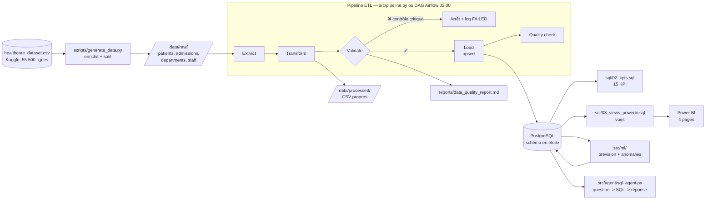
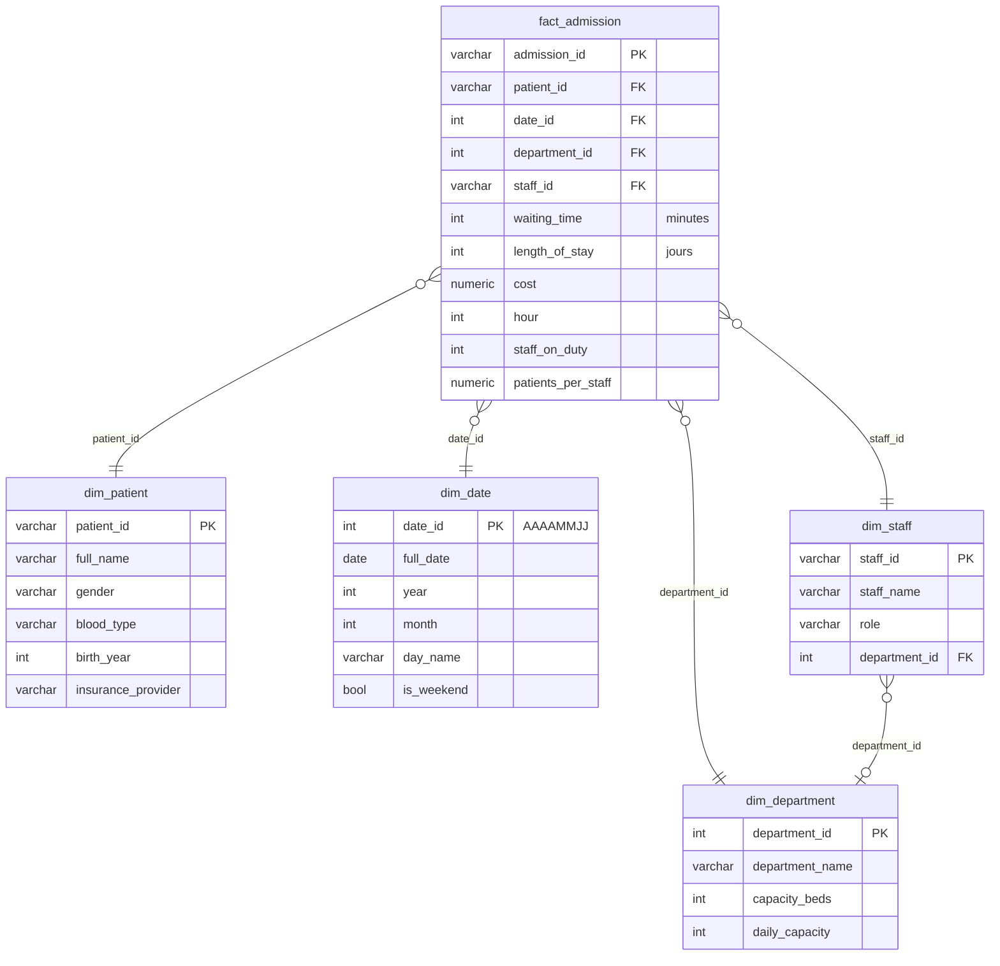

# Architecture — Hospital Operations Intelligence Platform

*Hanae MAYTA & Wafae ZALOUK*

## 1. Vue d'ensemble (Mermaid)

> Ce schéma s'affiche automatiquement sur GitHub, GitLab et dans VS Code (extension Markdown Preview Mermaid).



## 2. Vue d'ensemble (ASCII)

```
 healthcare_dataset.csv (Kaggle)
            │  scripts/generate_data.py  (enrichit : service, heure, attente, personnel
            ▼                             + salit : formats de dates, doublons, erreurs)
 data/raw/*.csv  ───────────────────────────────────────────────────────────────┐
                                                                                │
 ┌──────────────────────── PIPELINE (python -m src.pipeline / Airflow) ─────────▼────────┐
 │  EXTRACT ──► TRANSFORM ──► VALIDATE ──► LOAD ──► QUALITY CHECK                         │
 │  lit les CSV  nettoie,      28 contrôles  upsert dans   compte les lignes en base       │
 │               features      ✅/❌ ; stop    PostgreSQL    + 0 doublon                     │
 │                             si critique                                                │
 └────────────────────────────────┬───────────────────────────────────────────────────────┘
                                  ▼
                 ┌─────────── PostgreSQL : hospital_dw ───────────┐
                 │            dim_patient   dim_date               │
                 │                    ╲     ╱                      │
                 │                fact_admission                   │
                 │                    ╱     ╲                      │
                 │         dim_department   dim_staff              │
                 │  + pipeline_runs, ml_forecast, ml_daily_anomalies│
                 └──────┬──────────┬──────────┬──────────┬─────────┘
                        ▼          ▼          ▼          ▼
                   KPI SQL     Power BI     ML        Agent IA
```

## 3. Schéma en étoile



## 4. Le DAG Airflow

```
hospital_etl_pipeline   (tous les jours à 02:00, 2 nouvelles tentatives, catchup désactivé)

  extract ──► transform ──► validate ──► load ──► quality_check
     │            │             │           │
     ▼            ▼             ▼           ▼
 interim/raw.pkl  interim/clean.pkl      PostgreSQL + pipeline_runs
                  data/processed/*.csv
                  reports/data_quality_report.md
```

Chaque tâche Airflow tourne dans un processus séparé : elles se transmettent les données
via des fichiers intermédiaires dans `data/interim/` (et non via XCom, réservé aux petites valeurs).
